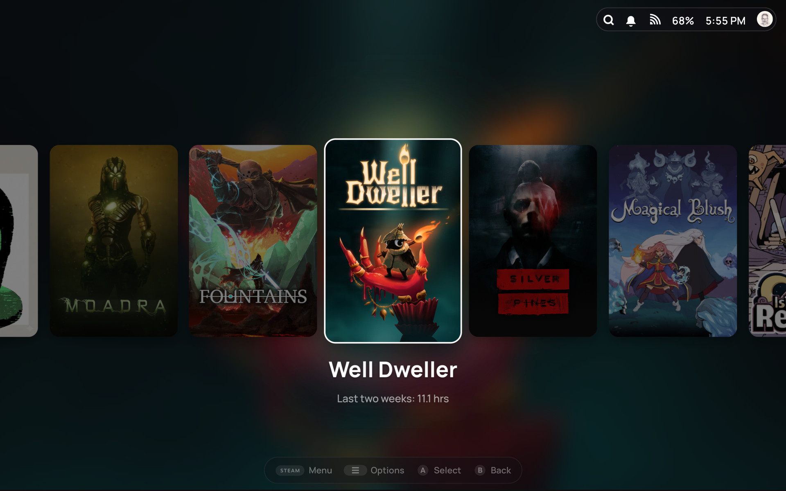
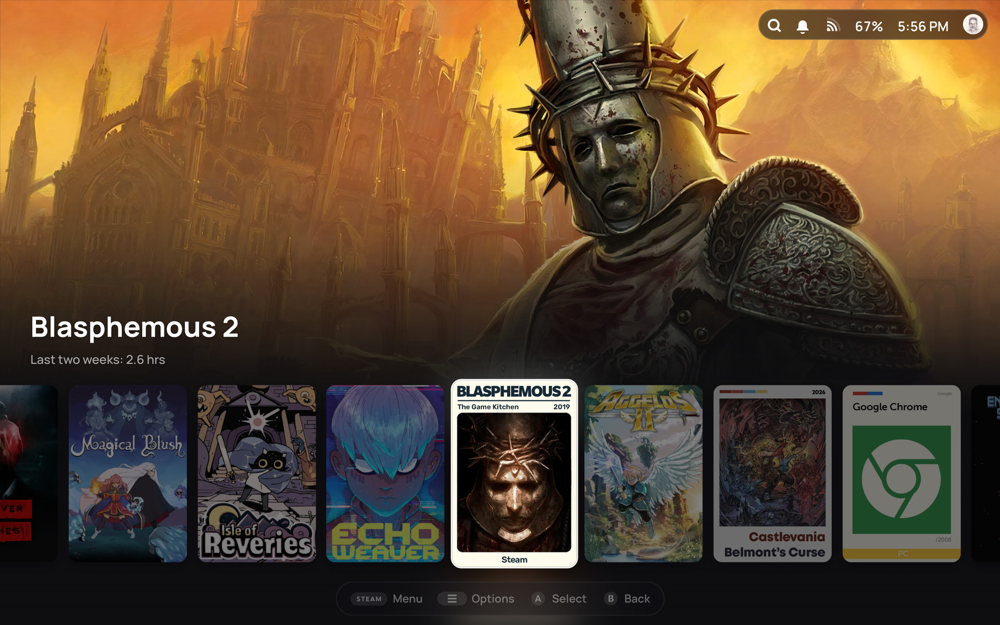
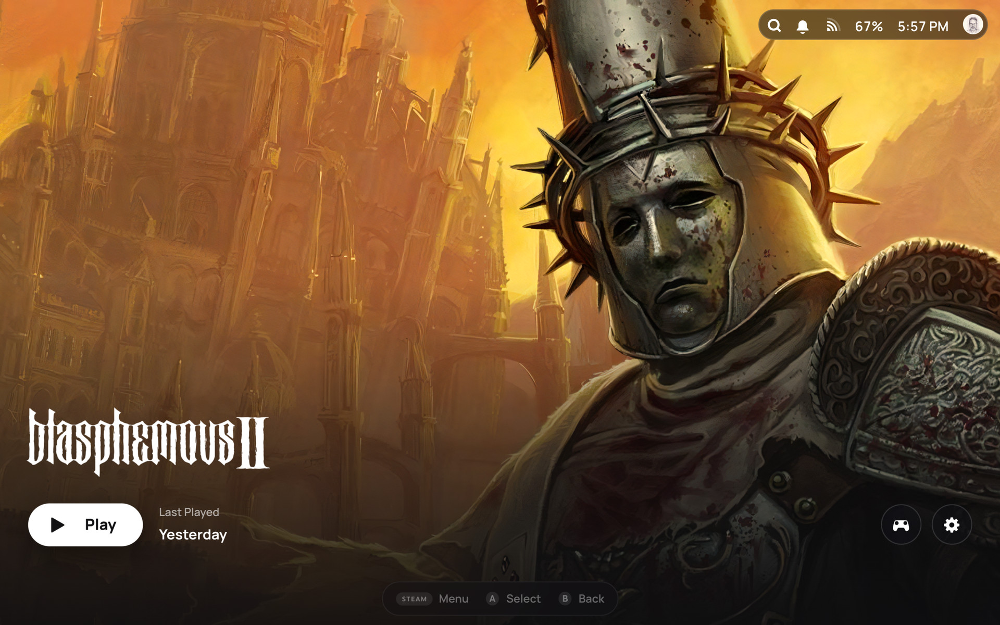
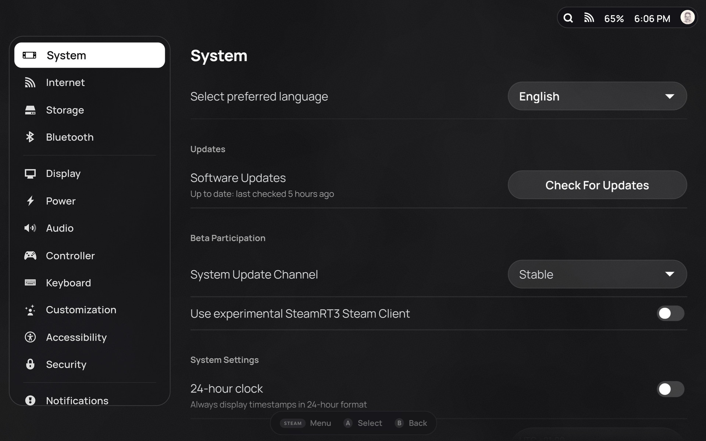
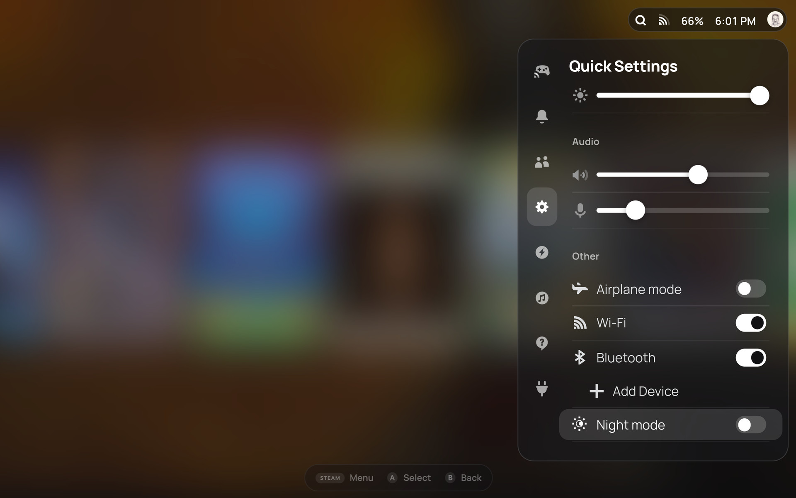

# Float

A minimal, art-first theme for the Steam Deck, for [CSS Loader](https://github.com/DeckThemes/SDH-CssLoader). Frosted, floating pills and cards over your games' art, white for focus, and Manrope type.

| | |
|---|---|
|  |  |
|  |  |

## Install

In gaming mode, go to Decky Loader → CSS Loader → theme store and search for "Float". It's also on [DeckThemes](https://deckthemes.com/themes/view?themeId=1ee17154-c237-42d9-a910-dbe92303950d).

To install a zip from [Releases](https://github.com/andrefgneves/float/releases) instead:

1. In Desktop Mode, create a folder called `Float` inside `~/homebrew/themes`. The name has to be exactly `Float`, or the font and icons won't load.
2. Unzip the files into that folder.
3. Back in gaming mode, press Refresh in CSS Loader.
4. Turn Float on.

A release can be newer than the store while an update waits for approval. If CSS Loader offers you an update in that time, skip it: it would install the store's older version.

## Options

Float's options are in CSS Loader:

- **Home layout:** Banner or Shelf
- **Cover size:** Small, Medium or Large
- **Shelf blur:** how much the Shelf layout blurs the game's art behind the row
- **Home tabs:** turn off to hide What's New, Friends and Recommended
- **Keyboard:** turn off to keep Steam's own on-screen keyboard

## Credits

Controller button glyphs and the Steam Deck drawing are Steam's own (© Valve), recoloured. Manrope © The Manrope Project Authors, under the SIL Open Font License.
